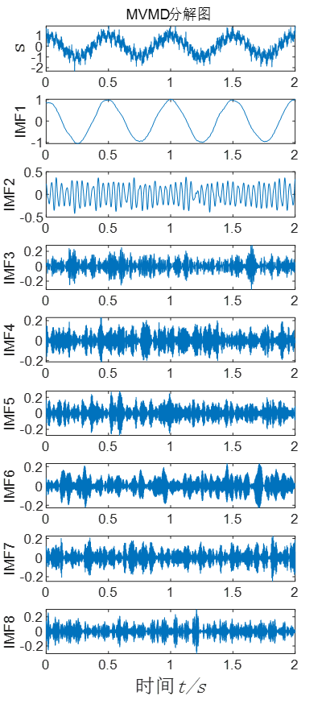
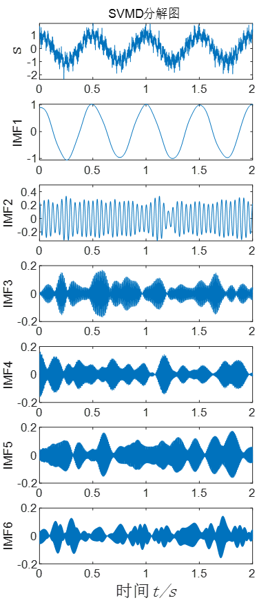
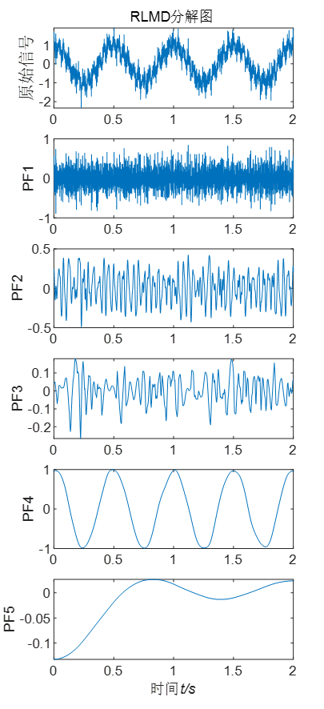
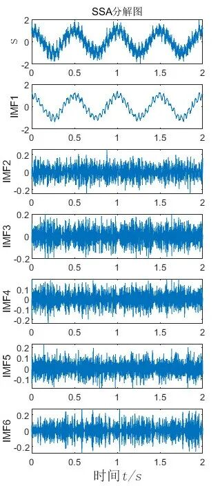
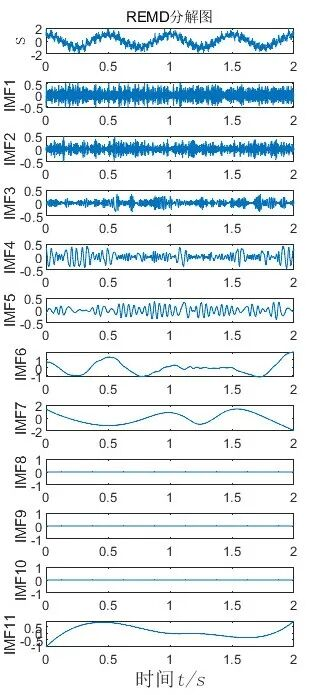
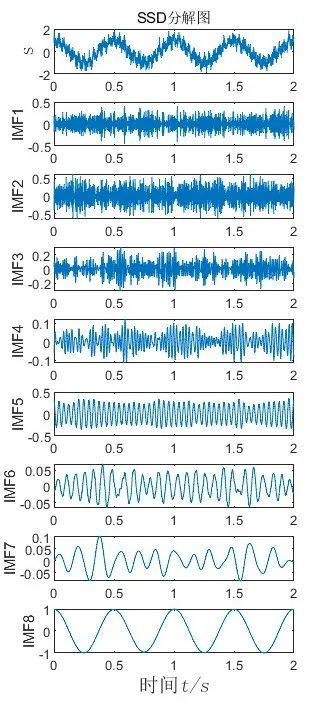
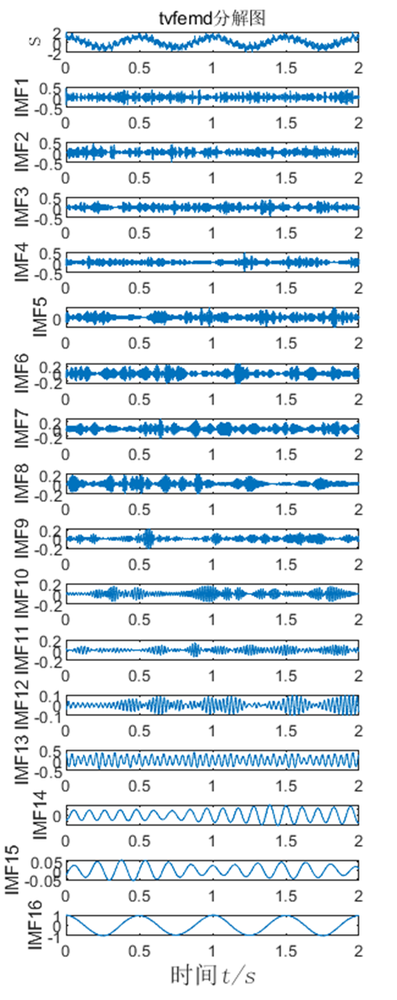

# 16 Data Decomposition Methods, randomly choose one, MATLAB code to implement data decomposition freely, take it all at once, hurry up!

16 Common Data Decomposition Methods
EMD (Empirical Mode Decomposition)
EEMD (Ensemble Empirical Mode Decomposition)
CEEMD (Complementary Ensemble Empirical Mode Decomposition)
FEEMD (Fast EEMD Decomposition)
CEEMDAN (Completely Adaptive Noise Ensemble Empirical Mode Decomposition)
ICEEMDAN (Improved Adaptive Noise Comprehensive EEMD)
LMD (Local Mean Decomposition)
RLMD (Robust Local Mean Decomposition)
EWT (Empirical Wavelet Decomposition)
VMD (Variational Mode Decomposition)
MVMD (Multivariate Variational Mode Decomposition)
SVMD (Successive Variational Mode Decomposition)
tvfemd (Time-varying Filtered Empirical Mode Decomposition)
SSD (Singular Spectrum Decomposition)
SSA (Singular Spectrum Analysis)
REMD (Robust Empirical Mode Decomposition)
In this issue, we have added four new data decomposition methods to the original 12 methods. The newly added methods are: tvfemd, SSD, SSA, and REMD.
For a simulated signal, we use 16 data decomposition methods (EMD, EEMD, CEEMD, FEEMD, CEEMDAN, ICEEMDAN, LMD, RLMD, EWT, VMD, MVMD, SVMD, tvfemd, SSD, SSA, REMD).
s4 is Gaussian white noise
s1, s2, s3 are signals of different frequencies, s4 is a Gaussian white noise signal, and the signal s is decomposed by these methods. The signals s1, s2, s3, s4, and s are shown in the following figure:
①EMD decomposition diagram
②EEMD decomposition diagram
③CEEMD decomposition diagram
④FEEMD decomposition diagram
⑤CEEMDAN decomposition diagram
⑥ICEEMDAN decomposition diagram
⑦LMD decomposition diagram
⑧EWT decomposition diagram
⑨VMD decomposition diagram
⑩MVMD decomposition diagram
⑪SVMD decomposition diagram
⑫RLMD decomposition diagram
⑬tvfemd decomposition diagram
⑭ SSD decomposition diagram
⑮SSA decomposition diagram
16 REMD decomposition diagram
If the image cannot be viewed, please visit gzh: Taojia Codes, search for the article title! Thank you for your support!
\n        \n  
\n        \n  
S)  

## Images

[16 Data Decomposition Methods Randomly Chosen, MATLAB Code to Achieve Free Data Decomposition, Take Everything at Once, Quick Look!](01.jpg)
[16 Data Decomposition Methods Randomly Chosen, MATLAB Code to Achieve Free Data Decomposition, Take Everything at Once, Quick Look!](02.jpg)
[16 Data Decomposition Methods Randomly Chosen, MATLAB Code to Achieve Free Data Decomposition, Take Everything at Once, Quick Look!](03.jpg)
[16 Data Decomposition Methods Randomly Chosen, MATLAB Code to Achieve Free Data Decomposition, Take Everything at Once, Quick Look!](04.jpg)
[16 Data Decomposition Methods Randomly Chosen, MATLAB Code to Achieve Free Data Decomposition, Take Everything at Once, Quick Look!](05.jpg)
[16 Data Decomposition Methods Randomly Chosen, MATLAB Code to Achieve Free Data Decomposition, Take Everything at Once, Quick Look!](06.jpg)
[16 Data Decomposition Methods Randomly Chosen, MATLAB Code to Achieve Free Data Decomposition, Take Everything at Once, Quick Look!](07.jpg)
[16 Data Decomposition Methods Randomly Chosen, MATLAB Code to Achieve Free Data Decomposition, Take Everything at Once, Quick Look!](08.jpg)
[16 Data Decomposition Methods Randomly Chosen, MATLAB Code to Achieve Free Data Decomposition, Take Everything at Once, Quick Look!](09.jpg)
[16 Data Decomposition Methods Randomly Chosen, MATLAB Code to Achieve Free Data Decomposition, Take Everything at Once, Quick Look!](10.jpg)
[16 Data Decomposition Methods Randomly Chosen, MATLAB Code to Achieve Free Data Decomposition, Take Everything at Once, Quick Look!](11.jpg)
[16 Data Decomposition Methods Randomly Chosen, MATLAB Code to Achieve Free Data Decomposition, Take Everything at Once, Quick Look!](12.jpg)

<!-- PAYMENT_BLOCK -->

## Get this dataset

- Payment link (Stripe): [Buy now](https://buy.stripe.com/3cs8yP7sY87d0vu9AB)
- Payment QR code: 

<!-- /PAYMENT_BLOCK -->
